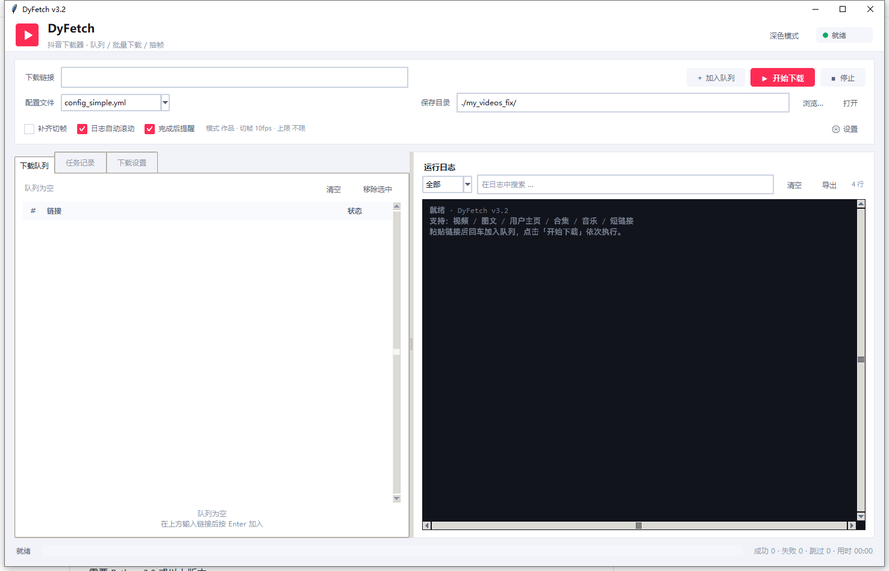

# DyFetch

DyFetch（抖音下载器）用于下载抖音平台的视频、图文、作者主页与合集内容，提供命令行与桌面图形界面
两种使用方式，下载完成后可按指定帧率抽帧。

主程序为 `downloader.py`，图形界面为 `ui.py`。

## 支持范围

- 视频作品与图文作品
- 作者主页：作品批量下载、点赞内容、合集列表
- 主页链接携带 `modal_id` 或 `vid` 参数时，仅下载该单一作品
- 合集页面与音乐页面下的作品列表
- `v.douyin.com` 形式的短链接

除主体内容外，可选择保存背景音乐、封面、作者头像与原始 JSON 数据，并将视频按秒抽帧至
`frames/` 目录。

当接口未返回数据时，程序会自动改用浏览器方式获取内容。因此公开作品在登录态失效的情况下
仍可下载，代价是单个作品的处理时间增加至 6 至 8 秒。

## 环境要求与安装

需要 Python 3.8 或以上版本。

```bash
pip install -r requirements.txt
```

抽帧默认使用 `imageio-ffmpeg` 内置的 ffmpeg，无需单独安装；系统中已存在 ffmpeg 时也可直接使用。

浏览器方式依赖 Playwright：

```bash
pip install playwright
playwright install chromium
```

`cut.py` 为独立的逐帧导出工具，依赖 OpenCV：

```bash
pip install opencv-python tqdm
```

## 登录凭据

抖音接口通常需要登录态。获取方式有两种。

**自动获取（推荐）**

```bash
python cookie_extractor.py
```

执行后将生成 `cookies.txt`、`cookies.pkl` 与 `storage_state.json`，程序会自动读取。

**手工填写**

在配置文件中直接填写 `cookies`，支持字符串或字典两种形式。`config_simple.yml` 默认为
`cookies: auto`，表示优先读取本地文件，缺失时再通过浏览器获取。

## 使用方式

### 命令行

下载单个作品：

```bash
python downloader.py -c config_simple.yml -u "https://www.douyin.com/video/1234567890123456789"
```

下载作者主页的全部作品：

```bash
python downloader.py -c config_simple.yml -u "https://www.douyin.com/user/MS4wLjABAAAA..."
```

若主页链接携带 `modal_id` 或 `vid` 参数，则仅下载对应作品，不遍历整页。

下载本人主页的点赞或收藏内容：

```bash
python downloader.py -c config_simple.yml -u "https://www.douyin.com/user/self?...&showTab=like"
```

指定输出目录，或为历史目录补充切帧：

```bash
python downloader.py -c config_simple.yml -u "https://www.douyin.com/user/SEC_USER_ID" --path "./Downloaded/"
python downloader.py -c config_simple.yml -u "https://www.douyin.com/user/SEC_USER_ID" --slice-backfill
```

参数说明：

| 参数 | 说明 |
| --- | --- |
| `-c, --config` | 配置文件路径，默认 `config.yml`，不存在时回退至 `config_simple.yml` |
| `-u, --url` | 一个或多个链接，可一次传入多项 |
| `-p, --path` | 输出目录，覆盖配置文件中的 `path` |
| `--auto-cookie` | 使用 Playwright 获取 Cookie |
| `--cookie` | 直接传入 Cookie 字符串 |
| `--slice-backfill` / `--no-slice-backfill` | 运行前是否对历史目录补充切帧 |
| `--refresh-session` | 刷新并保存登录态，不下载任何内容 |

### 图形界面

```bash
python ui.py
```



界面将链接加入下载队列后可批量执行，支持实时日志（按级别过滤、关键字搜索、导出）、
下载参数设置（抽帧帧率、数量上限、下载模式、并发与重试）、浅色与深色主题切换。
快捷键为 `Ctrl+Enter` 开始下载、`Esc` 停止任务。

界面中的设置写入独立的 `ui_run_config.yml`，不会修改原始配置文件。

## 输出结构

```
<path>/<作者昵称>/<发布时间>_<作品描述>_<作品ID>/
├── clip_1.mp4              图文作品的视频片段，或视频作品的分段文件
├── image_1.jpg             图文作品的图片
├── <文件夹名>.mp4          单个视频作品
├── <文件夹名>_music.mp3    背景音乐
├── <文件夹名>_cover.jpg    封面
├── <文件夹名>_data.json    原始元数据
└── frames/                 切帧结果
    └── clip_01_000001.jpg
```

文件夹名包含作品 ID，同一作者的不同作品不会写入同一目录。已存在的文件会被跳过，
重复执行不会重复下载。

## 配置说明

`config_simple.yml` 常用配置项：

```yaml
link:                     # 链接列表，与命令行的 -u 二选一
  - https://www.douyin.com/user/SEC_USER_ID

path: ./Downloaded/       # 输出目录

music: true               # 保存背景音乐
cover: true               # 保存封面
avatar: false             # 保存作者头像
json: true                # 保存原始 JSON

slice_videos: true        # 是否切帧
slice_fps: 10             # 每秒抽帧数
slice_subdir: frames      # 帧目录名称
slice_backfill_on_run: false   # 运行前为历史目录补充切帧
auto_install_ffmpeg: true      # 缺少 ffmpeg 时自动安装
# ffmpeg_bin: ffmpeg           # 也可指定 ffmpeg 可执行文件路径

mode:                     # 主页下载内容
  - post                  # post / like / mix

number:                   # 数量上限，0 表示不限制
  post: 0
  like: 0

thread: 5                 # 并发数
retry_times: 3            # 重试次数

cookies: auto             # auto / Cookie 字符串 / Cookie 字典

start_time: ""            # 时间过滤，格式 YYYY-MM-DD，包含首尾两天
end_time: ""
```

浏览器方式相关配置：

```yaml
user_posts_browser_recovery: true    # 主页作品抓取不全时使用浏览器补充
user_posts_browser_headless: false   # 补充时浏览器是否以无头模式运行

single_aweme_browser_recovery: true  # 单作品接口无数据时使用浏览器获取
single_aweme_browser_headless: true  # 单作品补充默认无头运行，速度较快
```

## 登录态与续期

登录态过期后，接口会返回 HTTP 200 但响应内容为空，容易被误判为程序故障。因此程序在启动时
会解析 `sid_guard` 判断有效期，过期时输出提示：

```
⚠ Cookie 登录状态已于 2026-04-05 22:23 过期，请重新运行 cookie_extractor.py 登录
```

为避免重复登录，程序会把服务端每次响应下发的 `Set-Cookie`（包括 `sessionid`、`sid_guard`
等）合并并写回 `cookies.txt`、`cookies.pkl` 与 `storage_state.json`。抖音在有效期内会持续
延长该会话，只要保持一定使用频率，登录态可长期有效。

程序启动时还会输出当前有效期，例如 `登录态有效期至 2026-11-18（剩余 30 天）`，图形界面右上角
同步显示。如需主动续期：

```bash
python downloader.py -c config_simple.yml --refresh-session
```

或点击界面中的「下载设置 → 续期登录」。该命令不会下载内容，仅读取浏览器中的最新登录态并写回本地。

自动续期失败后，程序会在 6 小时内跳过再次尝试（记录于 `.session_refresh_state.json`），
以避免每次运行产生额外等待。若已重新登录，可使用 `--refresh-session` 强制刷新。

以下情况无法通过程序规避，需要重新登录：登录态超过有效期且长期未使用；修改密码、
在其他设备退出登录；或触发平台风控。

## 主页批量下载

配置 `mode: post` 时下载主页中的全部作品，`number.post` 可限制数量，0 表示不限制。

登录态有效时通过接口分页获取，单个作品耗时通常不足 1 秒。登录态失效时，程序会打开浏览器
逐屏收集作品链接，再逐个打开作品页获取详情，速度明显下降。实测对含 26 条作品的主页，
在登录态失效的情况下完成 24 条作品下载、0 条失败，总耗时约 4 分钟。

点赞与合集内容仍依赖接口分页，需要有效登录态。

## 常见问题

### 下载数量为 0，或接口持续返回 403

首先查看启动时输出的登录态有效期提示。若显示已过期，重新执行 `python cookie_extractor.py`。
若未过期，检查 `number.post` 是否被设为 0 以外的值，以及目标内容是否需要登录才能访问。

### 主页作品下载不完整

程序依次尝试：接口分页、`iteminfo` 备用接口、`locate_item_id` 定位、浏览器逐屏收集。
前三种依赖登录态，最后一种不依赖但速度较慢。可将 `user_posts_browser_headless` 设为
`false`，在浏览器窗口可见的情况下手动完成登录。

### 切帧没有输出

先确认 `ffmpeg -version` 可正常执行，或在配置中指定 `ffmpeg_bin`。开启
`auto_install_ffmpeg` 时，程序会在缺少 ffmpeg 的情况下尝试安装 `imageio-ffmpeg`。

### 界面中文显示异常

界面与子进程统一使用 UTF-8。若系统区域设置较为特殊，可在启动前设置 `PYTHONUTF8=1`。

## 项目结构

```
douyin-downloader/
├── downloader.py          主程序，包含全部下载逻辑
├── ui.py                  桌面图形界面
├── cut.py                 逐帧导出工具（依赖 OpenCV，可选）
├── cookie_extractor.py    获取登录凭据
├── get_cookies_manual.py  手工获取凭据的辅助脚本
├── DouYinCommand.py       旧版命令行封装，保留兼容
├── config_simple.yml      日常使用的配置
├── config.yml             完整配置示例
├── config.example.yml     配置模板
├── apiproxy/              接口封装与请求策略
├── utils/                 日志等公共工具
├── tests/                 回归测试脚本
└── dy-downloader/         早期模块化实现，仅供参考
```

`dy-downloader/` 为早期拆分为模块的版本，功能不及当前的 `downloader.py`，依赖配置也独立，
仅作参考保留。

## 测试

主程序的回归脚本运行于临时目录，不会影响现有数据与登录凭据：

```bash
python tests/regress_downloader.py            # 离线校验，共 18 项
python tests/regress_downloader.py --network  # 额外校验真实接口
```

覆盖链接识别、ID 提取、文件命名、时间过滤、增量下载、数据库读写、切帧与补切帧，
以及 Cookie 自动续期。

`dy-downloader/` 自带 pytest 用例，依赖需单独安装，且须在其目录下运行，
否则根目录的 `utils/` 会遮蔽同名包：

```bash
cd dy-downloader
pip install -r requirements.txt
python -m pytest tests -q
```

## 运行时生成的文件

以下文件在运行过程中生成，删除后会自动重建，均已列入 `.gitignore`：

```
cookies.txt / cookies.pkl / storage_state.json        登录态
downloader.log / logs/ / ui_startup.log              日志
data.db                                              增量下载数据库
Downloaded/ / my_videos/ / my_videos_fix/            下载内容
ui_history.json / ui_state.json / ui_run_config.yml  界面状态与设置
.session_refresh_state.json                          自动续期尝试记录
```
